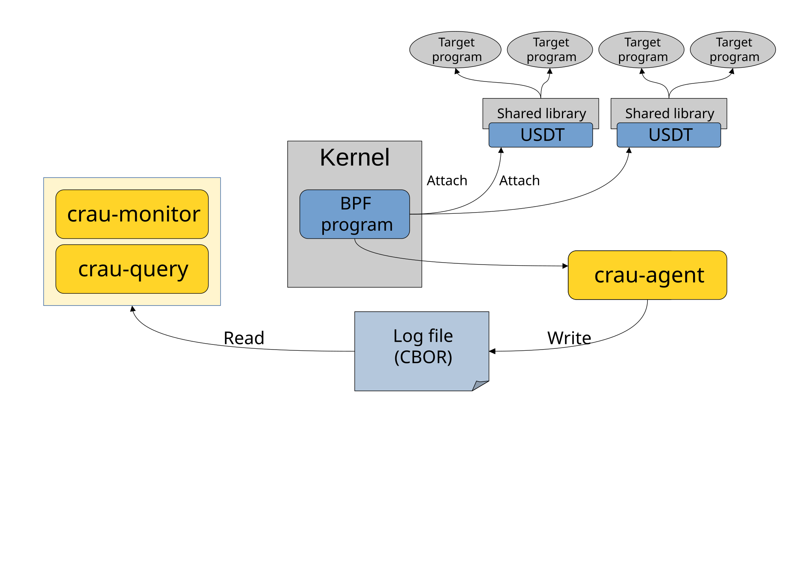

# Architecture

<!-- toc -->
- [Summary](#summary)
- [Design Details](#design-details)
  - [crau-agent](#crau-agent)
  - [Log analysis tools](#log-analysis-tools)
<!-- /toc -->

## Summary

This document gives an architectural overview of the crypto-auditing
project.

## Design Details

The following figure illustrates the overall architecture.

At the highest level, the architecture consists of two parts:
crau-agent and the log analysis tools (crau-query and crau-monitor).

crau-agent runs as a system service, receives cryptographic events
from the kernel through eBPF, and writes them to the primary log file.

The log analysis tools give users access to the primary log file.

### crau-agent

crau-agent is responsible for:

- Installing a BPF program that monitors USDT probes
- Receiving events when execution reaches a USDT probe
- Writing the received events to the primary log file

The agent is designed to run as fast as possible while consuming
minimal resources. The current implementation uses [BPF ring buffers]
to receive events from the kernel and [io_uring] to write them to disk
asynchronously.

### Log analysis tools

The log analysis tools provide access to the primary log file, either
after the fact or in real time. crau-query serves the former purpose,
and crau-monitor the latter.

[BPF ring buffers]: https://www.kernel.org/doc/html/latest/bpf/ringbuf.html
[io_uring]: https://en.wikipedia.org/wiki/Io_uring
